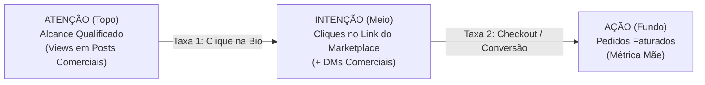
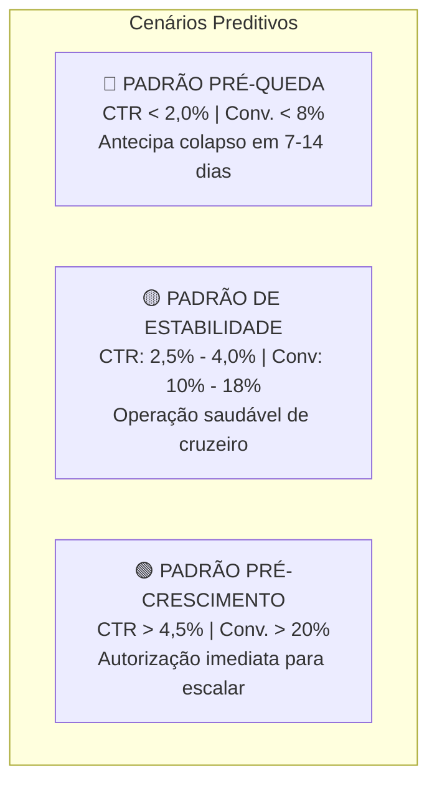

# Manual de Inteligência de Dados e Leitura Preditiva
**Projeto:** NanoGen Lab — E-commerce & Impressão 3D (Porta-Chaves Porsche GT3 RS / Universo Gearhead)  
**Sistema:** Creator Data Marketing System (DIO)  
**Data:** 29/09/2026  

---

## Parte 1: Definição da Métrica Central (Eixo do Sistema)

### 1. Objetivo Mãe de 90 Dias (Critério SMART)
* **Objetivo Comercial:** Atingir **R$ 9.786,00 em faturamento bruto trimestral** acumulado (140 unidades vendidas do Porta-Chaves Porsche GT3 RS ao ticket médio de R$ 69,90) ao longo dos próximos 90 dias, escalando a cadência de vendas de 2 unidades/semana (R$ 139,80) no Mês 1 para uma velocidade de cruzeiro de **15 unidades/semana (R$ 1.048,50)** ao término do Mês 3, sustentando margem de contribuição operacional líquida superior a **45%** sobre o custo dos insumos (filamento, energia e embalagem).
  * **Específico (S):** Foco unificado no produto campeão (Porta-Chaves Porsche GT3 RS) via tráfego orgânico/qualificado do Instagram Reels/TikTok para o marketplace.
  * **Mensurável (M):** 140 unidades faturadas e R$ 9.786,00 de receita bruta total.
  * **Atingível (A):** Exige elevar a taxa semanal de conversão aproveitando a transição de 75% da grade editorial para o formato demonstrativo/comercial já validado.
  * **Relevante (R):** Valida a tração do e-commerce, paga a amortização dos equipamentos 3D e estabelece previsibilidade de caixa.
  * **Temporal (T):** Prazo estrito de 90 dias corridos (12 ciclos semanais de monitoramento).

---

### 2. Isolamento da Métrica Mãe
* **A Única Métrica Mãe Inegociável:** **Pedidos Faturados Semanais (Unidades Liquidadas no Marketplace)**.
* **Justificativa Operacional:** O volume de pedidos faturados na semana é o único indicador de fluxo de caixa que confirma, de ponta a ponta, se o sistema atraiu a audiência certa, se a copy quebrou a fricção e se o cliente concluiu o pagamento. Se esse número cresce, a receita sobe e a meta SMART avança. Se ele zera, nenhuma outra métrica do sistema tem relevância.

---

### 3. O Teste de Invalidação de Vaidade
* **Métrica Superficial Invalida:** **Visualizações de Vídeo (Views) e Curtidas em Vídeos de Impressão 3D**.
* **Cenário de Invalidação em 2 Tópicos:**
  1. **Desalinhamento de Perfil de Público:** O algoritmo pode entregar um *time-lapse* hipnótico da extrusora 3D para 150.000 pessoas (crescimento de +500% de views), gerando milhares de curtidas de adolescentes, curiosos e entusiastas da tecnologia de impressão ao redor do mundo. Nenhum desses usuários é o cliente-alvo (o motorista *gearhead* dono de garagem que busca decoração automotiva). Resultado: o feed explode de engajamento superficial enquanto a loja virtual recebe zero visitas qualificadas.
  2. **Ausência Total de Intenção e Fricção de Compra:** Uma curtida custa zero esforço cognitivo e zero investimento financeiro. O usuário assiste ao vídeo como entretenimento passivo, não vê preço, não entende a utilidade prática do suporte de chaves na parede e não clica no link da bio. O perfil pode registrar um salto de 50% de engajamento social no mês enquanto o saldo bancário da NanoGen Lab permanece zerado e com estoque acumulado.

---

## Parte 2: Estruturação de Métricas Essenciais (Base do Sistema)

### 1. As 3 Métricas Essenciais de Transição da Jornada
A jornada do cliente é segmentada em 3 etapas com métricas objetivas de volume:



1. **Etapa 1: ATENÇÃO (Topo de Funil):**  
   * **Métrica:** *Alcance Único de Vídeos com Demonstração Prática e CTA de Oferta* (excluindo visualizações de vídeos de mero entretenimento técnico).
2. **Etapa 2: INTENÇÃO (Meio de Funil):**  
   * **Métrica:** *Cliques Únicos no Link da Bio direcionados à Página do Marketplace* + *DMs com Dúvidas Comerciais de Frete/Prazo*.
3. **Etapa 3: AÇÃO (Fundo de Funil):**  
   * **Métrica:** *Pedidos Concluídos e Faturados no Marketplace* (Métrica Mãe).

---

### 2. Tabela de Calibração de Taxas por Etapa

| Transição de Funil | Taxa Monitorada | Referência Saudável (Benchmark) | Limite de Alerta (Piso Crítico) | Racional da Calibração |
| :--- | :--- | :---: | :---: | :--- |
| **Topo $\to$ Meio**<br>(Atenção $\to$ Intenção) | **Taxa de Clique na Bio (CTR)**<br>$\frac{\text{Cliques no Link}}{\text{Alcance Comercial}} \times 100$ | **$\ge$ 3,5%** | **$<$ 2,0%** | No Post 4 campeão, 320 views geraram 14 cliques (4,37%). Uma taxa acima de 3,5% indica gancho alinhado com oferta. Abaixo de 2,0%, a CTA ou o gancho falharam. |
| **Meio $\to$ Fundo**<br>(Intenção $\to$ Ação) | **Taxa de Conversão da Loja**<br>$\frac{\text{Pedidos Faturados}}{\text{Cliques no Link}} \times 100$ | **$\ge$ 15,0%** | **$<$ 8,0%** | Com tráfego superqualificado de nicho (*gearhead*), 14 cliques geraram 3 vendas (21,4%). Se a conversão cair abaixo de 8%, há fricção grave de frete, preço ou fotos no anúncio. |

---

### 3. Matriz Operacional de Monitoramento Semanal

| Etapa / Taxa | Referência Saudável | Limite de Alerta (Piso) | O que Investigar / Corrigir ao Disparar Alerta |
| :--- | :---: | :---: | :--- |
| **1. Atenção (Topo):**<br>Alcance Comercial Semanal | $\ge$ 1.500 contas alcançadas na semana | $<$ 800 contas alcançadas na semana | • Auditar os primeiros 3 segundos do vídeo (o gancho do Porsche GT3 RS chamou atenção?).<br>• Verificar se o post foi bloqueado por diretrizes ou se o horário de postagem foi inadequado.<br>• Refazer o áudio utilizando ronco de motor em alta tendência (*trending audio*). |
| **2. Transição 1 (Topo $\to$ Meio):**<br>Taxa de Clique na Bio (CTR) | $\ge$ 3,5% dos visualizadores | $<$ 2,0% dos visualizadores | • Avaliar se a CTA final foi verbalizada e escrita de forma imperativa.<br>• Checar se o comentário fixado com o link foi publicado imediatamente.<br>• Inserir incentivo imediato de transição (ex: Cupom "GEARHEAD10" no final da legenda). |
| **3. Transição 2 (Meio $\to$ Fundo):**<br>Taxa de Conversão da Loja | $\ge$ 15% dos cliques viram vendas | $<$ 8% dos cliques viram vendas | • Testar o link da bio para garantir que o marketplace não está fora do ar.<br>• Avaliar valor e prazo do frete para regiões distantes.<br>• Verificar se o estoque do porta-chaves com a cor azul/vermelha está esgotado.<br>• Adicionar mais fotos de alta definição mostrando a fixação das chaves reais. |
| **4. Ação (Métrica Mãe):**<br>Volume de Pedidos Faturados | $\ge$ 8 vendas / semana (R$ 559,20) | $<$ 3 vendas / semana (R$ 209,70) | • Convocar sessão de guerra: pausar postagens genéricas.<br>• Disparar mensagem de recuperação de carrinho no e-commerce.<br>• Lançar campanha relâmpago de Stories com prova social de clientes enviando fotos. |

---

## Parte 3: Mapeamento de Sinais e Leitura Preditiva

### 1. Mapa Preditivo de Sinais Antecipados (3 Cenários da Operação)



| Cenário Preditivo | Faixa Numérica das Taxas | Comportamento Observado na Operação | Diagnóstico Preditivo & Ação Imediata |
| :--- | :--- | :--- | :--- |
| 🔴 **Padrão Pré-Queda**<br>*(Sinal de Alerta Vermelho)* | • **CTR Bio:** $<$ 2,0%<br>• **Conversão Loja:** $<$ 8,0%<br>• **Salvamentos:** $<$ 3 por post | O público assiste aos vídeos, mas não clica no link e o número de DMs cai a zero. O anúncio perdeu atratividade ou a oferta saturou. | **Antecipa queda de caixa em 7 a 14 dias.**<br>*Ação:* Congelar publicações agendadas. Substituir o criativo por um vídeo de teste de peso e resistência do gancho. Lançar nova variação de cor (ex: Preto Fosco com detalhes Amarelos). |
| 🟡 **Padrão de Estabilidade**<br>*(Operação Saudável)* | • **CTR Bio:** 2,5% a 4,0%<br>• **Conversão Loja:** 10,0% a 18,0%<br>• **Volume Semanal:** 5 a 8 vendas | O fluxo de visitantes é constante e previsível. As vendas entram no marketplace na mesma cadência das postagens comerciais. | **Operação em velocidade de cruzeiro.**<br>*Ação:* Manter rigorosamente o mix editorial de 75% focado em conversão e executar o ritual semanal sem alterações bruscas. |
| 🟢 **Padrão Pré-Crescimento**<br>*(Oportunidade de Escala)* | • **CTR Bio:** $>$ 4,5%<br>• **Conversão Loja:** $>$ 20,0%<br>• **DMs Comerciais:** $>$ 6 por semana | Alto volume de cliques, múltiplos compartilhamentos no direct entre entusiastas de carros e conversão imediata de compra. | **Janela de Aceleração de Caixa.**<br>*Ação:* Autorização imediata para dobrar a pauta de posts funcionais, criar versão combo (2 porta-chaves com desconto) e impulsionar tráfego pago no vídeo campeão. |

---

### 2. Identificação do Indicador Antecedente Primário
* **O Sismógrafo Antecedente:** **Taxa de Clique na Bio (CTR da Camada de Atenção $\to$ Intenção)**.
* **Por que ele é o primeiro a oscilar?**  
  A queda de faturamento no marketplace nunca acontece de surpresa: ela é precedida, invariavelmente, pela diminuição do fluxo de pessoas interessadas em clicar na bio. Quando o CTR cai de 4% para 1,5%, a loja ainda pode realizar 1 ou 2 vendas nos primeiros dias com leads residuais; porém, dentro de 5 a 10 dias, o checkout secará completamente. O CTR na Bio é a campainha de incêndio antecipada do negócio.

---

### 3. Checklist do Ritual Semanal de Governança (10 Minutos Cronometrados)
Realizado religiosamente toda **Segunda-feira às 09:00**:

```
[00:00 - 03:00] Passo 1: Extração e Alimentação de Dados
               ├─ Abrir painel do Instagram/TikTok e coletar: Alcance e Cliques no link.
               └─ Abrir painel do Marketplace: Pedidos Faturados e Receita Bruta.

[03:01 - 07:00] Passo 2: Leitura Hierárquica e Classificação de Cenário
               ├─ Calcular CTR da Bio (Cliques / Alcance) e Taxa da Loja (Vendas / Cliques).
               └─ Comparar com os pisos da matriz: Identificar se estamos em Vermelho, Amarelo ou Verde.

[07:01 - 10:00] Passo 3: Tomada de Decisão ou Disparo do Prompt de IA
               ├─ Se Estabilidade/Verde: Manter a grade e validar estoque de filamento.
               └─ Se Alerta/Vermelho: Disparar o Prompt de Correção na IA (abaixo).
```

#### Prompt de Acionamento Imediato da IA (Caso o Piso de Alerta seja Atingido):
```text
Atue como o CFO e Diretor de Growth da NanoGen Lab.
Na auditoria semanal de governança, nosso indicador antecedente disparou um sinal de ALERTA VERMELHO:
- Alcance semanal: [INSERIR]
- Cliques no link da bio: [INSERIR] (Taxa CTR calculada: [INSERIR]%)
- Pedidos faturados no marketplace: [INSERIR] (Taxa de Conversão: [INSERIR]%)
- Métrica Mãe da semana: [INSERIR] vendas (Piso mínimo: 3 vendas)

Com base no nosso Manual de Inteligência de Dados, me entregue um plano de ação emergencial de 48 horas contendo:
1. Hipótese central do vazamento micro (Gancho, CTA ou Fricção de Loja).
2. Roteiro cirúrgico para 1 novo Reel/TikTok com foco exclusivo em conversão imediata de caixa.
3. Ajuste de emergência na copy do anúncio do marketplace para recuperar vendas.
```

---

## Assinatura de Governança
> **"Na NanoGen Lab, os dados não servem para contar histórias passadas; servem para antecipar o futuro. Se a métrica não aponta para o caixa, ela é ruído."**
