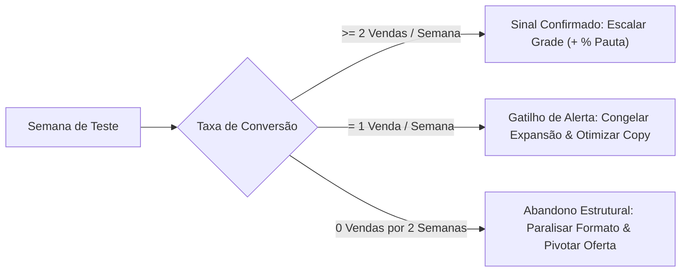

# Matriz de Mapeamento Emocional e Reclassificação por Dados
**Projeto:** NanoGen Lab — E-commerce & Impressão 3D (Porta-Chaves Porsche GT3 RS / Universo Gearhead)  
**Sistema:** Creator Data Marketing System (DIO)  
**Data:** 31/08/2026  

---

## Parte 1: Mapeamento de Decisão Emocional

### 1. Dados de Base do Negócio Auditado
* **Objetivo Comercial Principal:** Venda direta no e-commerce/marketplace do *Porta-Chaves de Parede Porsche GT3 RS* em impressão 3D premium (Ticket Médio: R$ 69,90).
* **Formato Repetido que Mais Gera Curtidas/Aplausos:** Vídeos estéticos em *time-lapse* da impressora 3D funcionando em alta velocidade e closes cinematográficos do acabamento do aerofólio (850 visualizações, 45 curtidas, elogios ao processo técnico).
* **Resultado Comercial Real desse Formato:** **R$ 0,00 em caixa** (0 pedidos no marketplace, apenas 1 DM de curioso perguntando qual era a marca do filamento 3D).
* **Formato Negligenciado com Mais Evidência de Venda:** Vídeo gravado em primeira pessoa demonstrando o porta-chaves fixado na parede de uma garagem, colocando as chaves do carro no gancho e fazendo chamada direta com link de desconto na bio (apenas 320 visualizações e 12 curtidas, mas gerou **3 vendas faturadas no marketplace e 2 DMs de compra**).

---

### 2. Diagnóstico do Ciclo de Recompensa (A Armadilha de Dopamina)
O criador foi capturado pelo **ciclo de validação do algoritmo**. Ao publicar o *time-lapse* da impressora 3D e closes estéticos, as notificações imediatas de curtidas e comentários como *"Que acabamento perfeito!"* ativaram picos de dopamina no cérebro do operador. 

Essa sensação de "sucesso de audiência" gerou uma **cegueira operacional**, levando a equipe a priorizar horas na edição de vídeos bonitos da manufatura em vez de focar na fricção de compra. A repetição do formato estético ocorreu porque o ego foi alimentado pela admiração da comunidade técnica (outros entusiastas de impressão 3D que nunca comprarão o produto final), mascarando a total ineficiência de tração de caixa.

---

### 3. Contraste: Sensação vs. Evidência

| Dimensão | O que foi Comemorado no Feed (Sensação) | O que foi Ignorado no Canal de Vendas (Evidência) | Nível de Maturidade Comercial |
| :--- | :--- | :--- | :--- |
| **Métrica** | 850 visualizações e 45 curtidas em um Reels/TikTok. | 0 cliques no link do produto no marketplace. | **Infantil:** Confundir audiência de entretenimento com cliente pagante. |
| **Mensagem** | "O algoritmo entregou bem, as pessoas estão adorando a qualidade da impressão." | O checkout ficou zerado, nenhum pedido foi despachado e o estoque permaneceu parado. | **Amador:** Otimizar métricas de topo de funil enquanto a conversão de fundo vaza 100%. |
| **Comportamento** | Produzir um novo vídeo de *time-lapse* para manter o número de notificações alto. | Apenas 1 post funcional de 320 views bancou R$ 209,70 de receita com margem líquida positiva. | **Profissional (Data-Driven):** Entender que visualização sem conversão é custo operacional, não receita. |

---

### 4. A Pausa Estratégica (Perguntas Anti-Vaidade)
Antes de liberar a gravação ou publicação de qualquer novo conteúdo na pauta da NanoGen Lab, o operador deve responder obrigatoriamente:

1. **"Este vídeo foi desenhado para vender o porta-chaves para um entusiasta automotivo (*gearhead*) ou foi desenhado para receber aplausos de outros donos de impressoras 3D?"**
2. **"Se este post atingir apenas 200 visualizações, a clareza da oferta e da chamada de compra é suficiente para gerar pelo menos 1 pedido faturado no marketplace?"**

---

## Parte 2: Reclassificação de Conteúdo por Evidência de Dados

### 1. Tabela de Reclassificação de Métricas do Histórico Recente

| Post Auditado | Formato / Tema | 🛑 VAIDADE (Ruído / Ego) | 🔍 ATENÇÃO QUALIFICADA (Interesse Ativo) | 💰 EVIDÊNCIA REAL (Ação / Caixa) | Diagnóstico Frio |
| :--- | :--- | :--- | :--- | :--- | :--- |
| **Post 1** | GT3 RS Estético (Foco em detalhes do design) | 620 Views 26 Curtidas | 1 Salvamento 2 Comentários de elogio | 0 Cliques 0 DMs 0 Vendas | **Ruído de Topo:** Atrai olhares, mas não ativa comportamento de consumo. |
| **Post 2** | *Time-lapse* do bico de extrusão imprimindo | 850 Views 45 Curtidas | 0 Salvamentos 1 DM sobre filamento | 0 Cliques 0 Vendas | **Armadilha de Dopamina:** Gera engajamento de terceiros sem fit comercial. |
| **Post 3** | Modelo 3D de carro JDM sem CTA | 500 Views 18 Curtidas | 2 Compartilhamentos | 0 Cliques 0 Vendas | **Desperdício de Tráfego:** Curiosidade dispersa sem ponte para o produto. |
| **Post 4** | Demonstração Prática na Parede + CTA de Compra | 320 Views 12 Curtidas | 8 Salvamentos 14 Cliques no link da Bio | **2 DMs comerciais 3 Vendas faturadas** | **Sinal Estrutural Campeão:** Baixo ruído social, alta intenção e conversão de caixa. |

---

### 2. Localização do Gargalo de Transição
* **Ponto de Quebra Percentual:** A maior queda do funil ocorre na transição entre **Atenção Qualificada e Evidência Real** nos Posts 1, 2 e 3 (queda de 100% — zero cliques no marketplace).
* **Causa Raiz:** Ausência de oferta explícita. O público consome o conteúdo como artefato visual de lazer e não recebe estímulo cognitivo nem instruções claras (preço, frete, link) para transitar para o ambiente de checkout.
* **Resolução pelo Post 4:** Ao apresentar a utilidade (chaves penduradas na parede) combinada com instrução direta de compra, a taxa de clique saltou para **4,37%** sobre o alcance e a taxa de conversão final foi de **~0,93%** das visualizações brutas em vendas reais.

---

### 3. Isolamento da Combinação Campeã
* **Formato Vencedor:** `Vídeo Curto em Primeira Pessoa com Demonstração Prática de Uso Real (Porta-Chaves na Parede) + Unboxing/Embalagem + CTA Direta com Benefício de Desconto`.
* **Canal:** Instagram Reels / TikTok com redirecionamento para o Link da Bio (Marketplace com entrega expressa).
* **Conclusão:** Este formato provou ser o **único Sinal Estrutural verdadeiro da conta**, devendo ser blindado e escalado com governança matemática.

---

## Parte 3: Plano Gradual e Réguas de Governança (Visão CFO / Growth)

### 1. Dados de Base para a Calibração
* **Ticket Médio Unitário:** R$ 69,90
* **Média Histórica do Formato Campeão:** 3 vendas por postagem qualificada (Receita direta: R$ 209,70 por publicação).
* **Meta de Transição Editorial:** Elevar a presença do formato campeão de **25%** para **75%** da grade de conteúdo ao longo de 4 semanas.

---

### 2. Régua de Calibração de Governança Numérica

* 🟢 **Critério de Confirmação de Sinal (Escala Aprovada):**
  * Manter uma média mínima de **>= 2 vendas faturadas por post campeão** durante **2 semanas consecutivas**.
  * Atingir taxa de cliques no link da bio superior a **3,5%** do alcance total do vídeo.
* 🟡 **Gatilho de Alerta / Revisão (Congelamento de Expansão):**
  * Se a média cair para **1 venda semanal** ou os cliques no link caírem abaixo de **2%**, o percentual da pauta é imediatamente congelado no estágio atual. É proibido avançar a transição sem antes revisar copy, ângulo do gancho e a oferta na página do marketplace.
* 🔴 **Critério de Abandono Estrutural (Descarte / Pivot):**
  * Se o formato registrar **0 vendas por 2 semanas consecutivas** (ou 4 postagens seguidas sem conversão), o formato é classificado como esgotado/saturado e retirado da pauta principal para revisão de produto e precificação.

---

### 3. Tabela do Plano Gradual de Transição (4 Semanas)

| Semana | % Pauta Formato Campeão (Oferta Prática) | % Pauta Topo de Funil (Atração / Bastidores) | Volume Semanal de Posts | Meta Mínima de Conversão | Gatilho de Contenção Operacional |
| :---: | :---: | :---: | :---: | :---: | :---: |
| **Semana 1 (S1)** | **25%** (1 post) | **75%** (3 posts) | 4 posts/sem | >= 2 vendas / R$ 139,80 | Se 0 vendas: ajustar CTA da bio e refazer gravação da fixação na parede. |
| **Semana 2 (S2)** | **50%** (2 posts) | **50%** (2 posts) | 4 posts/sem | >= 5 vendas / R$ 349,50 | Se < 3 vendas: pausar em 50% e não subir para S3; testar novo gancho automotivo. |
| **Semana 3 (S3)** | **70%** (3 posts) | **30%** (1 post) | 4 posts/sem | >= 8 vendas / R$ 559,20 | Se < 6 vendas: congelar expansão e auditar velocidade de carregamento da loja. |
| **Semana 4 (S4)** | **75%** (3 posts) | **25%** (1 post) | 4 posts/sem | >= 10 vendas / R$ 699,00 | Manter governança contínua; rodar protocolo de manutenção semanal de 30 min. |

---

### 4. Classificação de Cenários: Paciência Analítica vs. Procrastinação Editorial

* **O que é Paciência Analítica (Postura Correta baseada em Dados):**
  * Publicar um vídeo do formato campeão, verificar que ele teve apenas 280 visualizações em 48 horas, mas manter o plano porque ele gerou 12 cliques no marketplace e 2 vendas reais. Compreender que o volume algorítmico baixo é irrelevante frente ao retorno positivo sobre o esforço de produção.
* **O que é Procrastinação Editorial (Armadilha Emocional a Evitar):**
  * Voltar a gravar *time-lapses* de 15 horas na impressora 3D com a desculpa de *"preciso aquecer o público com vídeos bonitos antes de vender de novo"*. Isso é apenas a busca disfarçada por dopamina e validação social, postergando a disciplina de vendas.

---

### 5. Regra Decisional de Encerramento (Assinatura de Governança)
> **"Na NanoGen Lab, métricas que não pagam as faturas de filamento e energia são tratadas como custo de entretenimento. Cada linha da pauta agora responde à disciplina de conversão e governança de margem."**
