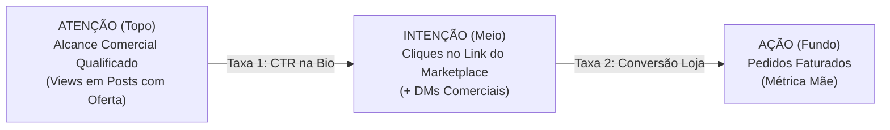
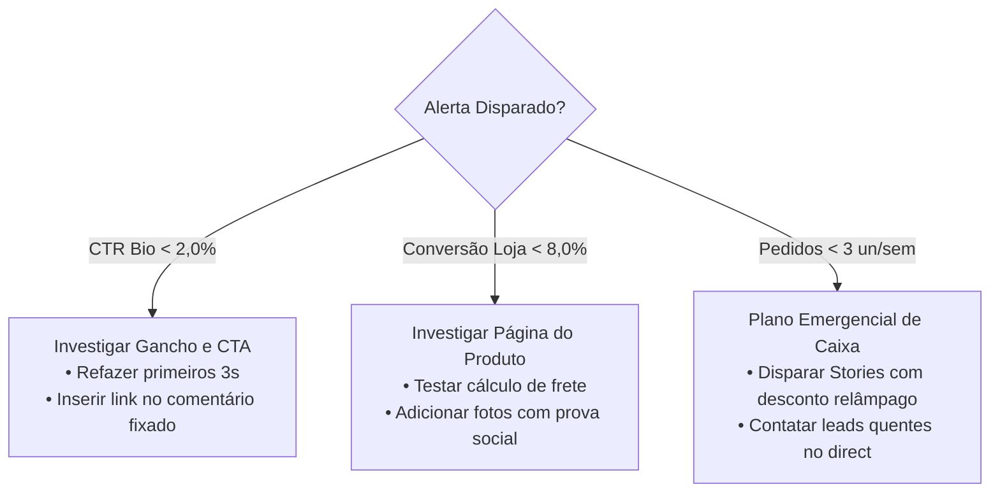

# Sistema Real de Decisão com Dados
**Manual Operacional de Inteligência e Governança**  
**Creator Data Marketing System — DIO**

---

### Cabeçalho de Identificação
* **Nome do Aluno:** Iago
* **Projeto / Empresa:** NanoGen Lab — E-commerce & Manufatura 3D (Linha Automotiva / *Gearhead*)
* **Produto de Foco:** Porta-Chaves de Parede Porsche GT3 RS (Impressão 3D Premium)
* **Ticket Médio:** R$ 69,90
* **Caminho Escolhido:** **Caminho B — Validação e Revisão do que já foi feito** (Operação com histórico auditado, métricas calibradas e transição editorial em andamento)
* **Data:** 29/09/2026

---

## Bloco 1 — Direção Estratégica e Métrica Mãe

### 1. Declaração do Objetivo Comercial de 90 Dias (SMART)
Atingir **R$ 9.786,00 em faturamento bruto trimestral** acumulado com a venda de **140 unidades** do *Porta-Chaves Porsche GT3 RS* nos próximos 90 dias (12 semanas operacionais). A meta prevê a transição da cadência de vendas de 2 unidades/semana (R$ 139,80) no primeiro mês para uma velocidade de cruzeiro de **15 unidades/semana (R$ 1.048,50)** ao final do terceiro mês, assegurando uma margem de contribuição líquida superior a **45%** após dedução de insumos (filamento PETG/PLA, energia, embalagem e comissão de marketplace).

* **Específico (S):** Escala de vendas de um único produto campeão (*Porta-Chaves Porsche GT3 RS*) via atração qualificada no Instagram Reels e TikTok e checkout no Marketplace.
* **Mensurável (M):** 140 unidades faturadas e R$ 9.786,00 de faturamento bruto total.
* **Atingível (A):** Sustentado pela migração de 75% da grade editorial para o formato demonstrativo prático (Post 4), cuja taxa de conversão histórica comprovada é de 0,93% sobre o alcance bruto.
* **Relevante (R):** Amortiza o maquinário de impressão 3D, financia novos moldes automotivos e valida a viabilidade de escala comercial do negócio.
* **Temporal (T):** Ciclo delimitado de 90 dias com auditorias semanais de governança.

### 2. Isolamento da Métrica Mãe Inegociável
* **A Métrica Mãe do Negócio:** **Pedidos Faturados Semanais (Unidades Liquidadas no Marketplace)**.
* **Justificativa Operacional:** É o único indicador de fluxo de caixa que sintetiza a eficácia de toda a cadeia: atração de público certo, retenção, clique na bio e superação das objeções no checkout. Se a Métrica Mãe cresce, o caixa expande; se estagna ou cai, nenhuma outra métrica do ecossistema tem valor comercial.

### 3. O Teste de Invalidação de Vaidade
* **Métrica Superficial Invalida:** **Visualizações de Vídeo (Views) e Curtidas em Vídeos de Impressão 3D**.
* **Demonstração em 2 Tópicos:**
  1. **Dispersão Algorítmica sem Fit Comercial:** Um vídeo em *time-lapse* acelerado da impressora 3D construindo o aerofólio pode acumular 100.000 visualizações e 5.000 curtidas por puro apelo estético ou curiosidade científica. No entanto, mais de 98% desse público é composto por entusiastas da tecnologia 3D ou estudantes que não possuem carro, não pertencem à cultura *gearhead* e jamais comprarão o produto de R$ 69,90.
  2. **Zero Fricção Cognitiva vs. Decisão de Compra:** Curtir ou comentar *"Que acabamento lindo!"* é uma ação passiva e gratuita. Ela não exige que o usuário clique no link da bio, enfrente o frete ou insira dados de cartão de crédito. Uma postagem pode crescer 50% em curtidas em relação à semana anterior e registrar **0 vendas no marketplace**, gerando falsa sensação de sucesso enquanto as despesas fixas da oficina permanecem descobertas.

---

## Bloco 2 — Tabela de Métricas Essenciais e Réguas de Saúde

### 1. Mapeamento das 3 Métricas da Jornada



1. **Atenção (Topo):** *Alcance Único de Vídeos com Demonstração Prática e CTA Explícita de Venda*.
2. **Intenção (Meio):** *Cliques Únicos no Link da Bio direcionados ao Marketplace* + *DMs com Dúvidas Comerciais*.
3. **Ação (Fundo):** *Pedidos Faturados no Marketplace* (Métrica Mãe).

### 2. Tabela de Calibração de Taxas por Etapa

| Etapa de Transição | Métrica / Taxa Calculada | Referência Saudável (Meta) | Limite de Alerta (Piso) | Racional Matemático de Calibração |
| :--- | :--- | :---: | :---: | :--- |
| **Topo $\to$ Meio**<br>(Atenção $\to$ Intenção) | **Taxa de Clique na Bio (CTR):**<br>$\frac{\text{Cliques no Link da Bio}}{\text{Alcance Comercial}} \times 100$ | **$\ge$ 3,5%** | **$<$ 2,0%** | Histórico do Post 4 gerou 14 cliques em 320 views (4,37%). Taxa $\ge$ 3,5% valida gancho e chamada eficientes. Abaixo de 2,0%, a CTA é fraca ou o público é desqualificado. |
| **Meio $\to$ Fundo**<br>(Intenção $\to$ Ação) | **Taxa de Conversão da Loja:**<br>$\frac{\text{Pedidos Faturados}}{\text{Cliques no Link da Bio}} \times 100$ | **$\ge$ 15,0%** | **$<$ 8,0%** | Em tráfego hiper-segmentado de nicho, 14 cliques converteram 3 compras (21,4%). Conversão abaixo de 8% acusa fricção de preço, prazo de frete ou descrição do anúncio. |

* **Prazo de Recalibração:** O conjunto de limites será revisado a cada **30 dias** com base na média móvel das 4 semanas anteriores.

### 3. Matriz Operacional de Monitoramento Semanal

| Etapa / Taxa | Referência Saudável | Limite de Alerta (Piso) | O que Investigar / Corrigir ao Disparar Alerta |
| :--- | :---: | :---: | :--- |
| **1. Atenção:**<br>Alcance Comercial Semanal | $\ge$ 1.500 contas | $<$ 800 contas | • Auditar os primeiros 3 segundos do vídeo (o gancho do Porsche GT3 RS prendeu atenção?).<br>• Substituir áudio por ronco de motor em tendência (*trending audio*).<br>• Validar se o algoritmo não aplicou restrição de visibilidade (*shadowban*). |
| **2. Transição 1:**<br>CTR no Link da Bio | $\ge$ 3,5% | $<$ 2,0% | • Verificar se a CTA foi clara, verbalizada e reforçada no comentário fixado.<br>• Alterar copy da bio destacando benefício imediato (ex: "Envio em 24h para todo o Brasil").<br>• Inserir cupom de desconto temporário no final da legenda. |
| **3. Transição 2:**<br>Conversão no Marketplace | $\ge$ 15,0% | $<$ 8,0% | • Testar link da bio para garantir que o marketplace não apresenta instabilidade técnica.<br>• Auditar fotos do anúncio: incluir fotos com chaves pesadas penduradas para provar firmeza.<br>• Checar opções de frete competitivo para as regiões Sudeste e Sul. |
| **4. Ação (Métrica Mãe):**<br>Pedidos Faturados Semanal | $\ge$ 8 pedidos | $<$ 3 pedidos | • Pausar imediatamente qualquer gravação de bastidores/estética.<br>• Publicar sequência de Stories com prova social e clientes reais utilizando o produto.<br>• Realizar ação de remarketing via direct com interessados que não fecharam na semana. |

---

## Bloco 3 — Mapa Preditivo e Indicador Antecedente

### 1. Mapa Preditivo de Sinais Antecipados (3 Cenários Operacionais)

| Cenário Preditivo | Faixa Numérica das Taxas | Diagnóstico Comportamental | *Lag Time* & Ação Imediata de Negócio |
| :--- | :--- | :--- | :--- |
| 🔴 **Padrão Pré-Queda**<br>*(Sinal de Alerta Crítico)* | • CTR Bio: $<$ 2,0%<br>• Conv. Loja: $<$ 8,0%<br>• Salvamentos: $<$ 3 / post | As pessoas assistem aos vídeos, mas não clicam na bio. O anúncio esgotou seu apelo ou a oferta perdeu força perante a audiência atual. | **Lag Time: 7 a 14 dias antes da queda de faturamento.**<br>*Ação:* Congelar pauta agendada. Gravar novo ângulo mostrando o teste de arrancada e resistência do suporte. Testar nova variação de cor (ex: Preto com detalhes Dourados). |
| 🟡 **Padrão de Estabilidade**<br>*(Operação Saudável)* | • CTR Bio: 2,5% a 4,0%<br>• Conv. Loja: 10% a 18%<br>• Vendas: 5 a 8 / semana | Fluxo harmônico e previsível. Os cliques na bio mantêm a loja alimentada e os pedidos são gerados sem solavancos. | **Lag Time: Neutro (ritmo de cruzeiro).**<br>*Ação:* Manter a proporção 75/25 na pauta editorial e cumprir o SOP semanal de 10 minutos sem alterar variáveis. |
| 🟢 **Padrão Pré-Crescimento**<br>*(Oportunidade de Escala)* | • CTR Bio: $>$ 4,5%<br>• Conv. Loja: $>$ 20,0%<br>• DMs de compra: $>$ 6 / sem | Alto volume de cliques qualificados, compartilhamentos espontâneos e conversão acelerada no marketplace. | **Lag Time: 3 a 5 dias para explosão de demanda.**<br>*Ação:* Autorização imediata para aumentar produção 3D, antecipar compra de filamento e ativar tráfego pago no vídeo campeão. |

### 2. O Indicador Antecedente Primário (O Sismógrafo do Negócio)
* **Indicador Antecedente:** **Taxa de Clique no Link da Bio (CTR da Camada de Atenção $\to$ Intenção)**.
* **Lógica de Desfasamento Temporal (*Lag Time*):**  
  A receita de um e-commerce nunca cai repentinamente; ela sempre avisa com dias de antecedência. Quando o CTR na bio desaba de 4,2% para 1,6%, a loja ainda pode apresentar vendas durante 48 a 72 horas consumindo visitantes que já haviam salvo o anúncio anteriormente. Contudo, o "funil secou". Em 7 a 14 dias, o faturamento cairá bruscamente a zero. O CTR na Bio é o primeiro indicador que pisca amarelo no painel de comando.

---

## Bloco 4 — Protocolo de Ação e Decisão Única

### 1. Matriz de Investigação Tática para Alertas Disparados



* **Se CTR Bio $<$ 2,0%:** O problema está estritamente no vídeo ou na chamada. É proibido mexer no preço ou no produto; deve-se alterar o gancho visual, o texto da legenda e fixar o comentário com o link.
* **Se Conversão Loja $<$ 8,0%:** O problema está na página de vendas do marketplace. É proibido culpar o vídeo; deve-se revisar o valor do frete, prazo de despacho, qualidade visual das fotos e clareza da descrição.
* **Se Pedidos Faturados $<$ 3 unidades:** Protocolo de contingência ativado. Pausa de investimentos e disparo de ação de recuperação direta na base existente.

### 2. Declaração da Decisão Única para o Próximo Ciclo
> **"Para o próximo ciclo de 7 dias, a NanoGen Lab executará a Decisão Única de produzir exclusivamente 3 publicações no formato campeão de demonstração prática em primeira pessoa (porta-chaves fixado na parede com teste de peso de chaves e CTA imperativa para o link da bio com cupom exclusivo), congelando 100% de publicações estéticas de time-lapse da impressora."**

* **Racional da Unicidade:** Mudar apenas uma variável por vez garante clareza absoluta de causa e efeito analítico, sem contaminar a leitura dos dados.

### 3. Protocolo de Resiliência para Semanas Atípicas
Em semanas de oscilação severa de mercado, feriados prolongados ou quedas globais de entrega algorítmica:
* Não alterar a precificação de forma impulsiva nem conceder descontos predatórios que comprometam a margem de 45%.
* Manter o cronograma do ritual semanal sem afobação, sustentando o volume de postagens comerciais até completar o ciclo de 14 dias de observação analítica.

---

## Bloco 5 — SOP do Ritual Semanal de 10 Minutos

Procedimento Operacional Padrão executado pontualmente **toda Segunda-feira, das 09:00 às 09:10**:

```
┌─────────────────────────────────────────────────────────────────────────────┐
│                 RITUAL SEMANAL DE GOVERNANÇA POR DADOS (10 MIN)             │
├─────────────────────────────────────────────────────────────────────────────┤
│ [00:00 - 02:00] PASSO 1: ALIMENTAÇÃO DE DADOS (2 min)                       │
│ ├─ Acessar Instagram Insights / TikTok Analytics: coletar Alcance e Cliques.│
│ └─ Acessar Painel do Marketplace: coletar Pedidos Faturados e Receita Bruta.│
│                                                                             │
│ [02:01 - 07:00] PASSO 2: LEITURA HIERÁRQUICA DO DASHBOARD (5 min)           │
│ ├─ 1º Olhar: Métrica Mãe (Atingiu >= 8 pedidos?).                           │
│ ├─ 2º Olhar: Indicador Antecedente CTR Bio (Ficou >= 3,5%?).                │
│ ├─ 3º Olhar: Taxa de Conversão da Loja (Ficou >= 15%?).                     │
│ └─ 4º Olhar: Enquadrar a semana no Mapa Preditivo (Vermelho, Amarelo, Verde)│
│                                                                             │
│ [07:01 - 10:00] PASSO 3: TOMADA DE DECISÃO OU ACIONAMENTO DA IA (3 min)     │
│ ├─ Se Verde / Amarelo: Confirmar a pauta da semana e liberar produção.       │
│ └─ Se Vermelho: Copiar dados e disparar o Prompt de Contingência na IA.     │
└─────────────────────────────────────────────────────────────────────────────┘
```

### Estrutura do Prompt de Acionamento da IA em Caso de Alerta:
```text
Você é o CFO e Diretor de Growth analítico da NanoGen Lab.
Na auditoria semanal de governança, nosso indicador antecedente disparou um sinal de ALERTA VERMELHO:
- Alcance comercial semanal: [INSERIR]
- Cliques no link da bio: [INSERIR] (CTR calculado: [INSERIR]%)
- Pedidos faturados no marketplace: [INSERIR] (Taxa de Conversão: [INSERIR]%)
- Métrica Mãe da semana: [INSERIR] pedidos (Piso mínimo: 3 pedidos)

Com base no nosso Manual Operacional de Governança, entregue um plano de ação emergencial de 48 horas contendo:
1. Hipótese central do gargalo (Gancho dos primeiros 3 segundos, CTA fraca ou fricção no anúncio do marketplace).
2. Roteiro cirúrgico para 1 novo Reel focado exclusivamente no teste de carga/peso do suporte com chamada de compra direta.
3. Ajuste tático na copy do anúncio e oferta para recuperar o piso de faturamento da semana.
```

---

## Assinatura de Governança e Encerramento
> **"Na NanoGen Lab, a intuição foi substituída pela evidência de dados. Toda linha da pauta editorial responde à governança de margem, protege o fluxo de caixa e constrói um negócio previsível e escalável."**

*Documento formalizado e pronto para submissão oficial no Desafio de Projeto do Creator Data Marketing System.*
